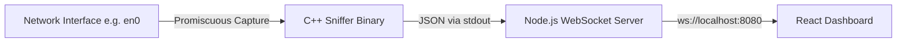

# NetWorld — Real-Time Network Packet Sniffer & Analyzer

[](https://en.cppreference.com/)
[](https://www.tcpdump.org/)
[](https://nodejs.org/)
[](https://react.dev/)
[](https://vitejs.dev/)

**NetWorld** is a high-performance network packet sniffer and real-time visualization tool. It pairs a low-level C++ packet capture engine powered by `libpcap` with a Node.js WebSocket bridge and an interactive, modern React dashboard.

---

## 📌 Architecture Overview



1. **C++ Core Engine (`sniffer.cpp`)**: Captures live frames in promiscuous mode via `libpcap`, decodes Ethernet, IPv4, TCP, and UDP headers, and streams structured packet summaries in JSON to `stdout`.
2. **WebSocket Bridge (`web/server.js`)**: Spawns the privileged sniffer process as a child process, buffers incoming streams, validates JSON packets, and broadcasts them across all connected clients.
3. **Frontend Dashboard (`web/frontend`)**: A reactive Web UI built with React 19 and Vite featuring live protocol counters, dynamic search and filtering, and stream controls (pause/resume/clear).

---

## ✨ Features

- **Deep Packet Inspection**:
  - **Ethernet (Layer 2)**: Source MAC, Destination MAC, Host MAC detection.
  - **IP (Layer 3)**: Source and Destination IPv4 addresses, packet length.
  - **Transport (Layer 4)**: TCP and UDP protocol decoding and port inspection.
- **Real-Time Streaming**: Instantaneous low-latency packet streaming over WebSockets with automatic reconnection.
- **Live Statistics**: Dynamic counters tracking total packets and breakdowns for TCP, UDP, and other protocols.
- **Fast Client-Side Filtering**:
  - Filter across Source/Destination IP, MAC addresses, and ports.
  - Protocol filter chips (`ALL`, `TCP`, `UDP`, `OTHER`).
- **Interactive Controls**:
  - **Pause / Resume** freeze display without dropping background stream metrics.
  - **Clear** buffer reset to keep focus on fresh traffic.
  - Sliding buffer capped to 500 recent packets for optimal rendering performance.

---

## 🛠️ Tech Stack

- **Capture Engine**: C++17, `libpcap`
- **Backend / Bridge**: Node.js, `ws` (WebSocket)
- **Frontend**: React 19, Vite, Modern CSS (Glassmorphism & CSS Variables)

---

## 🚀 Getting Started

### Prerequisites

- **macOS** or **Linux** with `libpcap` installed:
  - macOS: `libpcap` comes pre-installed with Xcode Command Line Tools (`xcode-select --install`).
  - Linux: `sudo apt-get install libpcap-dev`
- **C++ Compiler**: `clang++` or `g++` with C++17 support
- **Node.js**: v18+ and `npm`

### 1. Clone the Repository

```bash
git clone https://github.com/your-username/packet_sniffer.git
cd packet_sniffer
```

### 2. Compile the C++ Sniffer

Compile `sniffer.cpp` into a binary named `sniffer` in the project root:

```bash
clang++ -std=c++17 sniffer.cpp -lpcap -o sniffer
# or with g++:
# g++ -std=c++17 sniffer.cpp -lpcap -o sniffer
```

> **Note**: The default network interface is configured to `en0` in `sniffer.cpp`. Adjust this variable if your primary interface differs (e.g., `eth0` or `wlan0`).

### 3. Install Dependencies

Install root web dependencies and frontend dependencies:

```bash
cd web
npm install
cd frontend
npm install
cd ../..
```

### 4. Run the Application

You can launch both the WebSocket bridge server and the Vite frontend simultaneously:

```bash
cd web
npm start
```

Or run them in separate terminal tabs:

**Terminal 1 — WebSocket Server & Packet Sniffer:**
```bash
cd web
npm run server
```
*(Prompts for `sudo` password to allow promiscuous packet capture on the interface)*

**Terminal 2 — Frontend Dev Server:**
```bash
cd web/frontend
npm run dev
```

Open the dashboard in your browser at `http://localhost:5173`.

---

## 📂 Project Structure

```text
.
├── sniffer.cpp            # C++ packet capture engine (libpcap)
├── sniffer                # Compiled capture binary
└── web/
    ├── server.js          # Node.js WebSocket bridge & process supervisor
    ├── package.json       # Backend scripts and dependencies
    └── frontend/          # React + Vite application
        ├── src/
        │   ├── App.jsx           # Main packet analyzer UI
        │   ├── App.css           # Custom styling and animations
        │   ├── useWebSocket.js   # Custom hook for real-time streaming
        │   └── main.jsx          # React DOM entry point
        ├── index.html
        ├── package.json
        └── vite.config.js
```

---

## 🔒 Security & Permissions

Raw packet sniffing and promiscuous mode capture require elevated privileges:
- `web/server.js` executes `sudo ../sniffer` to capture raw packets across network interfaces.
- Ensure you have appropriate permissions on your host machine and network before running packet captures.

---

## 📄 License

This project is open-source and available under the [MIT License](LICENSE).

